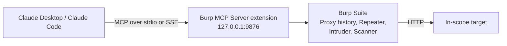

For a while, my "AI-assisted testing" workflow was copy a request out of Burp, paste it into a chat window, read the answer, paste a payload back into Repeater, repeat. It worked, but it was clunky, and any time I asked about exploitability or payload construction there was a decent chance the model's cyber safeguards would step in.

Two things changed that. First, my organisation was approved under **Anthropic's Cyber Verification Program (CVP)**. Second, PortSwigger ships an official **MCP Server** extension for Burp, which lets Claude talk to Burp directly instead of through my clipboard.

This post covers what CVP actually changes, then walks through the full setup for both **Claude Desktop** and **Claude Code**, and finishes with the guardrails I use so this doesn't become a liability on a client engagement.

> Everything here is for testing systems you are authorised to test. CVP doesn't change that — it makes it a condition of access.
{: .prompt-warning }

---

## Part 1: What the Cyber Verification Program changes

Anthropic's generally available Claude models run real-time cyber safeguards that block or interrupt high-risk dual-use work: exploit validation, malware analysis, adversarial simulation. For a pentester that's the job, so those interruptions happen a lot.

The CVP is Anthropic's free, application-based route around that for vetted security teams. A few things worth knowing before you apply:

- **It's organisation-scoped, not personal.** An admin applies using the organisation ID from your Claude / API account settings, verifies identity, and describes the defensive use case.
- **It's tiered.** On 6 October 2026 Anthropic merged the original CVP and Project Glasswing into one programme with three tiers — **Defense Access**, **Red Team Access** and **Specialized Access**. Red Team Access is the one that covers authorised penetration testing and simulated attacks, which is what this workflow needs. All tiers include Claude Opus 5.5, Sonnet 5.5 and Mythos 5.1.
- **Higher tiers need more proof.** Expect to show evidence of your security controls, not just fill in a form.
- **Data retention is generally required** so Anthropic can monitor for misuse. Factor that into your client data-handling conversations (more on that in Part 4).
- **Scope still matters.** You may only test systems you're authorised to assess, and some protections stay in place even at the higher tiers — Anthropic has called out critical infrastructure like grid, telecoms and interbank systems.

Once approved, nothing changes in how you *connect* tools. The difference is that Claude stops refusing the middle of a legitimate test. The MCP setup below works with or without CVP — you'll just get much further with it.

---

## Part 2: How the pieces fit together



The extension runs an MCP server *inside* Burp, listening on `http://127.0.0.1:9876` by default. Claude connects to it either:

- **Directly over SSE** — works with Claude Code and any client that supports remote/SSE servers.
- **Through a stdio proxy** — a small JAR bundled with the extension that bridges stdio to the SSE server. Claude Desktop uses this route.

Once connected, Claude gets tools to read proxy history, send HTTP/1.1 and HTTP/2 requests, open Repeater tabs, push requests to Intruder, pull scanner issues (Pro), and handle encoding utilities. The exact list lives in `src/main/kotlin/net/portswigger/mcp/tools/Tools.kt` in the repo — check it for your version, as it grows.

---

## Part 3: Step-by-step setup

### Prerequisites

- Burp Suite Professional or Community (scanner tools need Pro)
- Claude Desktop and/or Claude Code
- If building from source: Java and the `jar` command on your `PATH`

```bash
java --version
jar --version
```

### Step 1 — Install the MCP Server extension

**Option A: BApp Store (easiest).** In Burp go to **Extensions → BApp Store**, search for **MCP Server** (by PortSwigger) and click **Install**.

**Option B: Build from source.** Useful if you want the latest commits or plan to add your own tools.

```bash
git clone https://github.com/PortSwigger/mcp-server.git
cd mcp-server
./gradlew embedProxyJar
```

That produces `build/libs/burp-mcp-all.jar`. Load it via **Extensions → Installed → Add**, set **Extension type** to **Java**, select the JAR, and click **Next**.

### Step 2 — Configure the MCP tab

A new **MCP** tab appears in Burp. Check:

| Setting | What I use | Why |
|---|---|---|
| **Enabled** | On | Starts the server |
| **Enable tools that can edit your config** | **Off** | Stops Claude changing Burp project/user config. Turn on only if you really need it |
| **Host / Port** (advanced) | `127.0.0.1` / `9876` | Keep it on loopback. Never bind to `0.0.0.0` |

Confirm it's listening:

```bash
curl -i --max-time 3 http://127.0.0.1:9876
```

Any HTTP response (even an error status) means the server is up. "Connection refused" means it isn't enabled or the port is different.

### Step 3a — Connect Claude Desktop

Claude Desktop launches local servers over stdio, so it uses the bundled proxy JAR.

**Automatic:** in Burp's MCP tab, run the **installer** for Claude Desktop. It extracts the proxy JAR and writes the config entry for you. Restart Claude Desktop with Burp running.

**Manual:** use the installer's option to extract the proxy JAR, then edit your config file:

- macOS: `~/Library/Application Support/Claude/claude_desktop_config.json`
- Windows: `%APPDATA%\Claude\claude_desktop_config.json`

```json
{
  "mcpServers": {
    "burp": {
      "command": "/path/to/burp/bundled/java",
      "args": [
        "-jar",
        "/path/to/mcp-proxy-all.jar",
        "--sse-url",
        "http://127.0.0.1:9876"
      ]
    }
  }
}
```

Use the Java runtime bundled with Burp rather than your system Java to avoid version mismatches. Typical locations:

- macOS: `/Applications/Burp Suite Professional.app/Contents/Resources/jre.bundle/Contents/Home/bin/java`
- Windows: `C:\Program Files\BurpSuitePro\jre\bin\java.exe`
- Linux: `~/BurpSuitePro/jre/bin/java`

Fully quit and reopen Claude Desktop. Burp must already be running, or the proxy has nothing to connect to.

### Step 3b — Connect Claude Code

Claude Code can talk to the SSE server directly, no proxy JAR needed:

```bash
claude mcp add --transport sse burp http://127.0.0.1:9876
```

I scope it per engagement rather than globally, so the Burp tools only appear in that client's working folder:

```bash
cd ~/engagements/acme-webapp
claude mcp add --scope project --transport sse burp http://127.0.0.1:9876
```

Then check it:

```bash
claude mcp list
```

If your client version expects the explicit path, use `http://127.0.0.1:9876/sse`. If SSE gives you trouble, the stdio proxy works in Claude Code too:

```bash
claude mcp add burp -- /path/to/burp/java -jar /path/to/mcp-proxy-all.jar --sse-url http://127.0.0.1:9876
```

### Step 4 — Sanity check

With some traffic already in proxy history, start with something read-only:

> Using the Burp tools, list the last 20 requests in proxy history for `app.example-client.test` and group them by endpoint.

If Claude calls a Burp tool and returns your traffic, you're connected. In Claude Desktop you'll see the tool call and approval prompt; in Claude Code you'll see it in the transcript.

---

## Part 4: Guardrails I actually use

Connecting an AI to an intercepting proxy is powerful, and it's also a new way to make mistakes at machine speed. These are non-negotiable for me:

1. **Set Burp's target scope first.** Configure **Target → Scope** before you let Claude send anything, and tell Claude in the prompt what's in scope. Claude can send requests through Burp; scope is your safety net.
2. **Approve each request-sending tool call.** Leave "always allow" off for anything that sends traffic. Reading history is low risk; firing requests at a production API is not.
3. **Keep config editing disabled** unless you have a specific reason.
4. **Loopback only.** The MCP server has no authentication of its own. Bound to anything other than `127.0.0.1`, anyone on the network can drive your Burp.
5. **Think about the data.** Proxy history contains session cookies, tokens and client PII. Everything Claude reads goes to Anthropic, and CVP generally requires data retention. Check this against your rules of engagement and the client's data-processing terms *before* the test, and redact or use dedicated test accounts where you can.
6. **Treat target responses as untrusted input.** A response body could contain text aimed at the model ("ignore previous instructions and…"). Watch for tool calls you didn't ask for and stop if one appears.
7. **Keep your own evidence.** Claude is a fast assistant, not your report. Verify every finding manually in Repeater before it goes anywhere near a deliverable.

---

## Part 5: Workflows that have actually saved me time

Some prompts I reach for on authorised tests:

**Triage a noisy proxy history**
> Go through proxy history for the in-scope host. Identify endpoints that take an object ID in the path or body, and list which of them returned 200 for both user A's and user B's session. Don't send any new requests.

**Build an IDOR test plan, then execute with approval**
> For the endpoints you found, create a Repeater tab per endpoint with user B's cookie swapped in. Don't send them yet — I'll review first.

**Explain a scanner finding in context** (Pro)
> Pull the scanner issues for this host. For each high or medium, explain whether it's likely exploitable given the request/response, and what I'd need to confirm manually.

**Encoding and payload grunt work**
> Decode this JWT, explain the claims, and tell me what's interesting about the header.

The pattern that works best: let Claude **read and organise** freely, but make it **propose before it sends**. That keeps the speed-up without handing over control of what actually hits the target.

---

## Troubleshooting

| Symptom | Likely fix |
|---|---|
| Claude Desktop shows no Burp tools | Burp wasn't running when Claude started — start Burp first, then fully restart Claude Desktop |
| `Connection refused` on 9876 | MCP tab not enabled, or you changed the port — update the URL everywhere |
| `burp` shows as disconnected in `claude mcp list` | Re-check the URL; try `/sse` or switch to the stdio proxy |
| Java errors launching the proxy | Point `command` at Burp's bundled Java, not system Java |
| Claude still refuses mid-test | Confirm you're using the account/organisation enrolled in CVP, and the work fits your access tier |
| Scanner tools missing | Scanner tools need Burp Suite Professional |

---

## Wrapping up

The MCP extension turns Claude from something I paste into into something that sits alongside Burp, and CVP removes most of the friction on legitimate offensive work. Neither removes the need for scope, authorisation and judgement — if anything, they raise the stakes on getting those right.

Next up, I want to try adding a custom tool to the extension for our internal auth flow. I'll write that up when it works.

### References

- [PortSwigger MCP Server extension (GitHub)](https://github.com/PortSwigger/mcp-server)
- [MCP Server on the BApp Store](https://portswigger.net/bappstore/9952290f04ed4f628e624d0aa9dccebc)
- [Model Context Protocol](https://modelcontextprotocol.io/)
- [Anthropic widens access to AI cyber capabilities for vetted security teams — CSO Online](https://www.csoonline.com/article/4231812/anthropic-widens-access-to-ai-cyber-capabilities-for-vetted-security-teams.html)
- [Anthropic loosens Claude's cyber restrictions for verified defenders — Help Net Security](https://www.helpnetsecurity.com/?p=387030)
